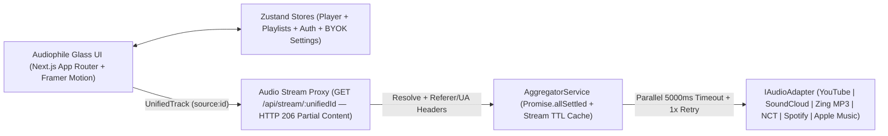

<div align="center">


# HnBee Music

**Unified Multi-Source Audiophile Music Streaming — Hợp nhất Spotify, YouTube & SoundCloud trong một không gian Glassmorphism 60fps.**

[](./LICENSE)
[](https://nextjs.org/)
[](https://www.typescriptlang.org/)
[](https://tailwindcss.com/)
[](https://www.framer.com/motion/)
[](https://zustand-demo.pmnd.rs/)

<br />

[](https://hnbeemusic.vercel.app)
&nbsp;
[](https://vercel.com/new/clone?repository-url=https%3A%2F%2Fgithub.com%2FHnguynbeeIT%2FHnBeeMusic&env=YOUTUBE_API_KEY,SPOTIFY_CLIENT_ID,SPOTIFY_CLIENT_SECRET&envDescription=T%C3%B9y%20ch%E1%BB%8Dn%20-%20C%C3%B3%20th%E1%BB%83%20%C4%91%E1%BB%83%20tr%E1%BB%91ng%20v%C3%A0%20nh%E1%BA%ADp%20sau%20qua%20API%20Settings%20Modal)

</div>

---

## Tính năng nổi bật

- **Multi-Source Unified Audio Engine**: Phát liền mạch nhạc từ **Spotify**, **YouTube** và **SoundCloud** trên cùng một hàng đợi (`UnifiedTrack`), cơ chế **Single Active Engine** tự động dừng & reset nguồn cũ khi đổi nguồn, tích hợp **Media Session API** (phím cứng bàn phím & màn hình khóa).
- **Zero-Interrupt Playback**: `AudioEngineManager` và Floating Glass Player Bar nằm cố định trong Root Layout — chuyển trang giữa *Khám phá*, *Trending*, *Tìm kiếm*, *Thư viện* không bao giờ ngắt nhạc.
- **Lazy Spotify Stream Matching & Auto SoundCloud Client ID**:
  - Dán link **Spotify Track / Playlist / Album** hoặc **YouTube Video / Playlist** để nạp vào Queue tức thì.
  - Chỉ map bài Spotify sang Official Audio trên YouTube/SoundCloud (độ lệch `< 5s`, lọc nhiễu `cover/remix/live/reaction`) khi phát để tiết kiệm quota.
  - Tự động trích xuất và cache `client_id` công khai của SoundCloud — người tự host không cần đăng ký app SoundCloud.
- **Synced Lyrics (LRCLIB — Miễn phí, không cần API Key)**: Tự động đồng bộ lời bài hát theo thời gian thực (`[mm:ss.xx]`), tự cuộn mượt theo tiến độ phát, bấm vào bất kỳ câu nào để tua (`seekTo`) đến đúng giây đó.
- **Cross-Platform Playlists**: Tạo, đổi tên, quản lý playlist trộn lẫn bài hát từ Spotify, YouTube & SoundCloud; hỗ trợ thả tim `Liked Songs` và đồng bộ PostgreSQL hoặc `localStorage`.
- **Zero-Verification Dual-Mode Auth**:
  - Tạo tài khoản nhanh chỉ với `username` + `password` (không cần email, OTP hay số điện thoại), có chống spam Rate Limit (5 tài khoản/giờ/IP).
  - Có `DATABASE_URL` → lưu PostgreSQL (`bcryptjs` + HTTP-only Cookie JWT bằng `jose`). Không có `DATABASE_URL` → tự chạy **Local Browser Profile** kèm **Export / Import `.json`** sao lưu toàn bộ Playlist, Liked Songs & API Keys.
- **BYOK (Bring Your Own Key)**: Nút **API Settings** ngay trên Sidebar cho phép người dùng bản demo online tự nhập API Key cá nhân (chỉ lưu ở `localStorage` của trình duyệt).
- **Audiophile Glassmorphism & 60fps Motion**: Nền sâu `#09090b`, **Dynamic Ambient Glow** tự đổi màu theo ảnh bìa & nguồn phát (`#1DB954` / `#FF0000` / `#FF5500`), animation tăng tốc GPU bằng Framer Motion (`layoutId`, spring physics, `<AudioEqualizer />`).

---

## Kiến trúc hệ thống (Multi-Platform Adapter Pattern & Stream Proxy)



## Platform Matrix (Bảng Trạng Thái Nền Tảng)

| Nền tảng | `PlatformSource` | Trạng thái | Luồng phát & Chất lượng | Synced Lyrics | Biến `.env` liên quan |
|---|---|---|---|---|---|
| **YouTube** | `youtube` | ✅ Hoạt động | Direct Audio (`youtubei.js`, `128kbps`–`320kbps`) + `expiresAt` | Qua LRCLIB | `YOUTUBE_API_KEY` *(tùy chọn)* |
| **SoundCloud** | `soundcloud` | ✅ Hoạt động | Direct Progressive MP3 / HLS (`128kbps`–`320kbps`) | Qua LRCLIB | `SOUNDCLOUD_CLIENT_ID` *(tự trích xuất nếu trống)* |
| **Zing MP3** | `zingmp3` | ✅ Hoạt động | Direct MP3/M4A (`128kbps` miễn phí / `320kbps` với VIP cookie) | ✅ Có (`sentences` / LRC) | `ZINGMP3_COOKIE`, `ZINGMP3_API_KEY`, `ZINGMP3_SECRET_KEY` *(tùy chọn)* |
| **NhacCuaTui** | `nct` | ✅ Hoạt động | Direct MP3/M4A (`128kbps`–`320kbps`, tự cấp token + XML fallback) | ✅ Có (`lrc`) | `NCT_ACCESS_TOKEN`, `NCT_API_SECRET` *(tùy chọn)* |
| **Spotify** | `spotify` | ✅ Hoạt động (`requiresSdk: true`) | Metadata + Preview / Web Playback SDK (Widevine DRM) | Qua LRCLIB | `SPOTIFY_CLIENT_ID`, `SPOTIFY_CLIENT_SECRET` |
| **Apple Music** | `apple_music` | ✅ Hoạt động (`requiresSdk: true`) | MusicKit / iTunes Catalog + AAC Preview / MusicKit JS SDK (FairPlay DRM) | Qua LRCLIB | `APPLE_MUSIC_DEVELOPER_TOKEN`, `APPLE_MUSIC_STOREFRONT` *(tùy chọn)* |
| **Deezer / Tidal / Bandcamp / Jamendo** | `deezer`, `tidal`, `bandcamp`, `jamendo` | 🔜 Sẵn sàng mở rộng | Đã chuẩn hóa sẵn trong `PlatformSource` & `BaseAdapter` | — | — |

---

## Cài đặt Local trong 3 bước

Yêu cầu: **Node.js 18+** và **npm**.

```bash
# Bước 1: Clone repository
git clone https://github.com/HnguynbeeIT/HnBeeMusic.git
cd HnBeeMusic

# Bước 2: Cài đặt thư viện & tạo file cấu hình môi trường (tùy chọn)
npm install
cp .env.example .env.local

# Bước 3: Khởi chạy ứng dụng
npm run dev
```

Mở **[http://localhost:3000](http://localhost:3000)** để trải nghiệm ngay!

> **Chạy ngay không cần cấu hình**: Ứng dụng đi kèm 10 bài hát mẫu đa nguồn, tự động tìm kiếm SoundCloud & Synced Lyrics LRCLIB miễn phí, và chế độ **Local Browser Profile**. Bạn có thể thêm `YOUTUBE_API_KEY`, `SPOTIFY_CLIENT_ID`, `SPOTIFY_CLIENT_SECRET` vào `.env.local` (xem hướng dẫn lấy miễn phí tại [.env.example](./.env.example)) hoặc nhập trực tiếp qua nút **API Settings** trên giao diện.

---

## Deploy lên Vercel (Production)

1. Bấm nút **Deploy with Vercel** ở đầu trang này (trỏ trực tiếp tới `https://github.com/HnguynbeeIT/HnBeeMusic`).
2. (Tùy chọn) Thêm các biến môi trường trên Vercel Dashboard → **Settings → Environment Variables**:
   - `YOUTUBE_API_KEY`
   - `SPOTIFY_CLIENT_ID` & `SPOTIFY_CLIENT_SECRET`
   - `DATABASE_URL` & `AUTH_JWT_SECRET` (nếu muốn bật Cloud DB Sync cho tài khoản & playlist)
3. Bấm **Deploy** — cấu hình `vercel.json` và `next.config.ts` đã được tối ưu sẵn cho Serverless Functions và ảnh bìa chất lượng cao từ YouTube, Spotify, SoundCloud.

---

## Đóng góp mã nguồn

Mọi đóng góp (Pull Request, Issue, hoặc thêm `AudioAdapter` mới như Zing MP3, NhacCuaTui, Apple Music...) đều được hoan nghênh! Xem chi tiết tại [CONTRIBUTING.md](./CONTRIBUTING.md).

---

## Miễn trừ trách nhiệm bản quyền (Disclaimer)

- **HnBee Music** là dự án mã nguồn mở phục vụ mục đích học tập, nghiên cứu kỹ thuật và trải nghiệm cá nhân.
- Ứng dụng **không lưu trữ, không host lại và không cung cấp tính năng tải xuống** bất kỳ tệp âm thanh có bản quyền nào.
- Mọi nội dung âm thanh, hình ảnh và metadata đều được phát trực tiếp từ các nền tảng gốc thông qua trình phát nhúng chính thức (**YouTube IFrame Player API**, **SoundCloud Widget API**) và các API công khai (**Spotify Web API / oEmbed**, **LRCLIB**).
- Toàn bộ quyền sở hữu trí tuệ thuộc về nghệ sĩ, hãng thu âm và nền tảng tương ứng. Người dùng tự chịu trách nhiệm tuân thủ Điều khoản Dịch vụ (ToS) của các bên thứ ba khi tự triển khai (self-host) hoặc sử dụng API Key cá nhân.

## Author / Maintainer

- **Tác giả**: **Nguyễn Ngọc Hà Nguyên (HnBeeStudio)** — `@_hnguynbee.hng_` ([HnguynbeeIT](https://github.com/HnguynbeeIT))
- **Portfolio**: [hanguynbeeit-portfolio.vercel.app](https://hanguynbeeit-portfolio.vercel.app)
- **Windows Desktop (.exe)**: [Tải xuống bản mới nhất (GitHub Releases)](https://github.com/HnguynbeeIT/HnBeeMusic/releases/latest)

## Giấy phép

Phát hành dưới giấy phép **[MIT License](./LICENSE)** © 2026 Nguyễn Ngọc Hà Nguyên (HnBeeStudio).
