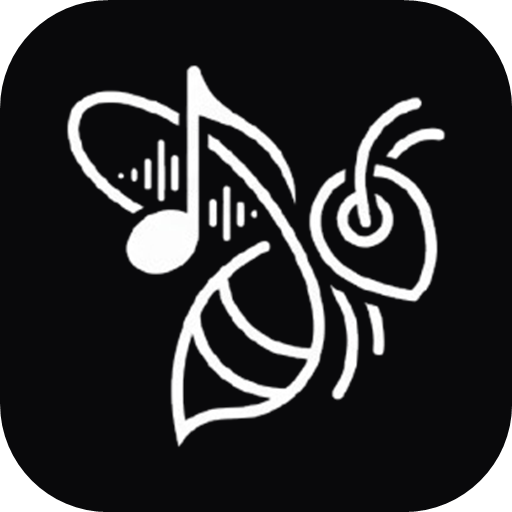

<div align="center">



# HnBeeMusic

**Nền tảng nghe nhạc đa nguồn chuẩn Audiophile — Hợp nhất YouTube, SoundCloud, Spotify, Zing MP3, NhacCuaTui & Apple Music trên cùng một giao diện Dark Glassmorphism 60fps.**

[](./LICENSE)
[](https://hnbeemusic.vercel.app)
[](https://nextjs.org/)
[](https://react.dev/)
[](https://www.typescriptlang.org/)
[](https://tailwindcss.com/)
[-47848F?logo=electron&logoColor=white)](https://github.com/HnguynbeeIT/HnBeeMusic/releases/latest)

<br />

[](https://hnbeemusic.vercel.app)
&nbsp;
[-10B981?style=for-the-badge&logo=windows&logoColor=white)](https://github.com/HnguynbeeIT/HnBeeMusic/releases/latest/download/HnBee-Music-Setup.exe)
&nbsp;
[](https://vercel.com/new/clone?repository-url=https%3A%2F%2Fgithub.com%2FHnguynbeeIT%2FHnBeeMusic)

</div>

---

## 1. Giới thiệu & Tính năng nổi bật (Features)

**HnBeeMusic** (phát triển bởi **HnBee Technologies — HNT**) là ứng dụng nghe nhạc đa nền tảng hỗ trợ đồng thời **Web App**, **iOS/Android PWA** và **Windows Desktop (`.exe`)**, được thiết kế theo kiến trúc **Multi-Platform Adapter Pattern** và **Audio Stream Proxy**.

### Các tính năng thực tế đang hoạt động
- **Multi-Platform Adapter Pattern & Aggregator Service (`src/adapters/`, `src/services/aggregator.service.ts`)**:
  - Chuẩn hóa dữ liệu đa nền tảng về `UnifiedTrack` (`unifiedId: "${source}:${id}"`) và `StreamData`.
  - Tìm kiếm song song qua `AggregatorService.searchAll()` dùng `Promise.allSettled()`, cô lập lỗi độc lập (`timeout: 5000ms`, tự động retry `1` lần khi lỗi mạng) và trộn kết quả đều theo từng nền tảng.
  - Tích hợp **TTL Cache** theo `expiresAt` cho luồng phát để tối ưu tốc độ và giảm tải gọi API gốc.
- **Audio Stream Proxy hỗ trợ HTTP `206 Partial Content` (`GET /api/stream/:unifiedId`, `/api/audio-proxy`)**:
  - Tự động giải mã `source:id`, đính kèm header chống chặn CORS/Hotlink (`Referer`, `User-Agent`, `Origin`, `Cookie`) khi pipe luồng âm thanh về client.
  - Hỗ trợ đầy đủ HTTP `Range` (`bytes=0-`), tua nhạc mượt mà và tự động làm mới URL đã ký khi upstream trả về `403`/`410`.
- **Zero-Interrupt Playback & Crossfade / Gapless Preload**:
  - `AudioEngineManager` và thanh phát nhạc nổi (`BottomPlayerBar`) cố định tại Root Layout — chuyển trang giữa *Khám phá*, *Trending*, *Tìm kiếm*, *Thư viện*, *Nghệ sĩ* không bao giờ bị ngắt nhạc.
  - Hỗ trợ **Crossfade mượt (`0s–8s`)**, tải trước ngầm bài hát kế tiếp, cơ chế **Single Active Engine** chống chồng âm thanh và **SponsorBlock** tự động bỏ qua đoạn quảng cáo/intro trong MV YouTube.
- **Tối ưu phát nhạc nền trên iOS / PWA**:
  - **iOS Instant Audio Unlock**, luồng âm thanh trực tiếp qua `/api/audio-proxy`, giữ phiên âm thanh nền khi khóa màn hình hoặc thoát ra màn hình chính, tích hợp **Media Session API** (Màn hình khóa & Dynamic Island), giao diện 4 tab chuẩn iOS HIG và hỗ trợ vuốt xuống (`Swipe Down`) để đóng Lyrics/Player.
- **Synced Lyrics thời gian thực (Karaoke Mode)**:
  - Đồng bộ lời bài hát theo từng câu/giây qua **LRCLIB** (miễn phí, không cần API key) cùng lời đồng bộ trực tiếp từ **Zing MP3** (`sentences`/LRC) & **NhacCuaTui**, cho phép bấm vào từng dòng lời để tua tới đúng thời điểm.
- **Tài khoản OAuth, Server Cloud Sync & BYOK (Bring Your Own Key)**:
  - Đăng nhập nhanh bằng **Google / Facebook OAuth** (HttpOnly JWT Cookie bằng `jose`) hoặc tài khoản cục bộ (`bcryptjs` + Rate Limit), tự động đồng bộ *Playlist cá nhân*, *Liked Songs* và *Nghệ sĩ theo dõi* qua PostgreSQL / Supabase REST RPC.
  - Chế độ **BYOK** (`ApiSettingsModal`): Người dùng có thể tự nhập API Key cá nhân (lưu cục bộ trên trình duyệt) mà không cần chỉnh sửa server.
- **Ứng dụng Windows Desktop gốc (`desktop/` — Electron 35)**:
  - Frameless Dark TitleBar (`titleBarOverlay` `36px` + vùng kéo cửa sổ `-webkit-app-region: drag`), **System Tray** chạy nền khi bấm dấu X, **Windows Taskbar Thumbnail Toolbar** (`Bài trước`, `Phát/Tạm dừng`, `Bài tiếp theo`), phím Media vật lý toàn hệ thống, `Single Instance Lock`, lưu vị trí cửa sổ và đăng nhập OAuth an toàn qua trình duyệt gốc + Deep Link **`hnbeemusic://`**.

---

## 2. Bảng tổng hợp nền tảng (Platform Matrix)

| Nền tảng | `PlatformSource` | Trạng thái | Cơ chế phát | Chi tiết kỹ thuật & Chất lượng | File Adapter |
|---|---|---|---|---|---|
| **YouTube** | `youtube` | ✅ Hoạt động | Direct Stream + Proxy / IFrame Fallback | `youtubei.js` (Innertube), trích xuất `audio/mp4` (`128kbps`–`320kbps`) kèm `expiresAt`, SponsorBlock | [`youtube.adapter.ts`](./src/adapters/youtube.adapter.ts) |
| **SoundCloud** | `soundcloud` | ✅ Hoạt động | Direct Stream + Proxy / Widget Fallback | API v2 tự trích xuất `client_id` công khai, Progressive MP3 / HLS (`128kbps`–`320kbps`) | [`soundcloud.adapter.ts`](./src/adapters/soundcloud.adapter.ts) |
| **Zing MP3** | `zingmp3` | ✅ Hoạt động | Direct Stream + Proxy | Ký `SHA-256 + HMAC-SHA512` (`sig`), hỗ trợ cookie VIP (`320kbps`), bản miễn phí (`128kbps`), Synced Lyrics | [`zingmp3.adapter.ts`](./src/adapters/zingmp3.adapter.ts) |
| **NhacCuaTui** | `nct` | ✅ Hoạt động | Direct Stream + Proxy | Đàm phán token phiên MD5 + fallback HTML5 XML, MP3/M4A (`128kbps`–`320kbps`), Synced Lyrics | [`nct.adapter.ts`](./src/adapters/nct.adapter.ts) |
| **Spotify** | `spotify` | ✅ Hoạt động | SDK (`requiresSdk: true`) + Lazy Bridge | OAuth Client Credentials + Embed `__NEXT_DATA__` fallback; Widevine DRM cần Web Playback SDK hoặc bridge | [`spotify.adapter.ts`](./src/adapters/spotify.adapter.ts) |
| **Apple Music** | `apple_music` | ✅ Hoạt động | SDK (`requiresSdk: true`) + AAC Preview | MusicKit API v1 + iTunes Catalog Search fallback; FairPlay DRM cần MusicKit JS SDK, có AAC preview | [`apple-music.adapter.ts`](./src/adapters/apple-music.adapter.ts) |
| **Deezer** | `deezer` | 📋 Kế hoạch | Direct Preview / SDK | Đã định nghĩa trong `PlatformSource` (`src/types/audio.ts`) | — |
| **Tidal** | `tidal` | 📋 Kế hoạch | Hi-Res / SDK | Đã định nghĩa trong `PlatformSource` (`src/types/audio.ts`) | — |
| **Bandcamp** | `bandcamp` | 📋 Kế hoạch | Direct Stream + Proxy | Đã định nghĩa trong `PlatformSource` (`src/types/audio.ts`) | — |
| **Jamendo** | `jamendo` | 📋 Kế hoạch | Direct Stream (CC License) | Đã định nghĩa trong `PlatformSource` (`src/types/audio.ts`) | — |

---

## 3. Kiến trúc hệ thống (Architecture)

```text
+----------------------------------------------------------------------------------+
|                       CLIENT (Web / iOS PWA / Electron .exe)                     |
|   Next.js 15 App Router  |  Zustand Stores  |  AudioEngineManager & Player Bar   |
+----------------------------------------+-----------------------------------------+
                                         |
                 1. Search / Metadata    |    2. GET /api/stream/:unifiedId
                 (Debounced / Unified)   |       Header: Range: bytes=0-
                                         v
+----------------------------------------------------------------------------------+
|                   AUDIO STREAM PROXY (stream.controller.ts)                      |
|   - Parse unifiedId ("source:id")                                                |
|   - Attach StreamData.headers (Referer, User-Agent, Origin, Cookie)              |
|   - Pipe upstream bytes -> HTTP 206 Partial Content (Accept-Ranges: bytes)       |
|   - Auto-refresh signed URL on upstream 403 / 410                                |
+----------------------------------------+-----------------------------------------+
                                         |
                                         v
+----------------------------------------------------------------------------------+
|                  AGGREGATOR SERVICE (aggregator.service.ts)                      |
|   - searchAll(): Promise.allSettled() across registered adapters + round-robin   |
|   - getStreamUrl(): In-memory TTL Cache honoring upstream expiresAt              |
|   - getTrackInfo() / getLyrics(): Unified delegation by PlatformSource           |
+----------------------------------------+-----------------------------------------+
                                         |
                     IAudioAdapter (inherits BaseAdapter:
                     5000ms timeout, 1x retry, fault isolation)
                                         |
       +-----------------+---------------+---------------+-----------------+
       |                 |                               |                 |
       v                 v                               v                 v
+--------------+  +--------------+               +--------------+  +---------------+
|   YouTube    |  |  SoundCloud  |               |   Zing MP3   |  |  NhacCuaTui   |
| youtubei.js  |  | API v2 + HLS |               | HMAC-SHA512  |  | MD5 Token/XML |
+--------------+  +--------------+               +--------------+  +---------------+
       |                 |
       v                 v
+--------------+  +--------------+
|   Spotify    |  | Apple Music  |
| Web API/SDK  |  | MusicKit/SDK |
+--------------+  +--------------+
```

### Cấu trúc thư mục lõi
```text
HnBeeMusic/
├── desktop/                          # Ứng dụng Windows Desktop (Electron 35 + electron-builder)
│   ├── main.js                       # Frameless TitleBar, System Tray, Taskbar Thumbar, hnbeemusic://
│   ├── preload.js                    # ContextBridge an toàn (sandbox: true, contextIsolation: true)
│   └── package.json                  # Cấu hình build NSIS Setup & Portable .exe
├── src/
│   ├── types/audio.ts                # PlatformSource, UnifiedTrack, StreamData, IAudioAdapter
│   ├── adapters/                     # BaseAdapter + 6 Platform Adapters (VN & Global) + index.ts
│   ├── services/aggregator.service.ts# AggregatorService (Promise.allSettled + Stream TTL Cache)
│   ├── controllers/stream.controller.ts # Xử lý Stream Proxy HTTP 206 Partial Content
│   ├── app/api/                      # Next.js Route Handlers (/api/stream/[unifiedId], /api/auth/*, ...)
│   ├── components/                   # Giao diện Glassmorphism, Player, Lyrics, Auth, Sidebar
│   ├── lib/                          # Auth JWT/OAuth, SponsorBlock, Lyrics, Audio helpers
│   └── store/                        # Zustand Stores (Player, PlaybackTime, Playlists, Auth, Settings)
├── sql/ & supabase/migrations/       # Lược đồ PostgreSQL / Supabase Cloud Sync
├── .env.example                      # Mẫu biến môi trường (không chứa khóa thật)
├── CHANGELOG.md                      # Nhật ký phiên bản (v1.0.0 -> v2.5.1)
└── SECURITY.md                       # Chính sách bảo mật & quy trình xử lý sự cố
```

---

## 4. Hướng dẫn cài đặt & Cấu hình (Getting Started & BYOK)

### Yêu cầu hệ thống
- **Node.js 20+** và **npm** (khuyến nghị Node.js 20/22 LTS).

### Bước 1: Clone & cài đặt dependencies
```bash
git clone https://github.com/HnguynbeeIT/HnBeeMusic.git
cd HnBeeMusic
npm install
```

### Bước 2: Khởi tạo biến môi trường
```bash
cp .env.example .env.local
```
> **Chạy ngay không cần cấu hình (Zero-Key Mode):** Ứng dụng hoạt động ngay lập tức với **YouTube** (`youtubei.js`), **SoundCloud** (tự trích xuất `client_id`), **Zing MP3** (128kbps), **Apple Music** (iTunes Search fallback), **Synced Lyrics LRCLIB** và **Local Browser Profile**. Người dùng cũng có thể nhập API Key cá nhân trực tiếp trên giao diện qua nút **API Settings (BYOK)**.

### Danh sách biến môi trường (`.env.example`)

| Biến môi trường | Nhóm | Bắt buộc | Mô tả |
|---|---|---|---|
| `SPOTIFY_CLIENT_ID` | Spotify Web API | Tùy chọn | Client ID từ Spotify Developer Dashboard (tìm kiếm & trích xuất playlist) |
| `SPOTIFY_CLIENT_SECRET` | Spotify Web API | Tùy chọn | Client Secret (chỉ dùng phía Server, không dùng `NEXT_PUBLIC_`) |
| `YOUTUBE_API_KEY` | YouTube Data API v3 | Tùy chọn | Bổ trợ tìm kiếm metadata (có fallback `youtubei.js` / `ytInitialData` nếu để trống) |
| `SOUNDCLOUD_CLIENT_ID` | SoundCloud | Tùy chọn | Ghi đè `client_id` (tự động trích xuất từ bundle công khai nếu để trống) |
| `APPLE_MUSIC_DEVELOPER_TOKEN` | Apple Music | Tùy chọn | MusicKit Developer JWT Token (tự fallback sang iTunes Search API nếu để trống) |
| `APPLE_MUSIC_STOREFRONT` | Apple Music | Tùy chọn | Mã vùng cửa hàng mặc định (ví dụ: `vn`, `us`, `jp`) |
| `ZINGMP3_COOKIE` | Zing MP3 | Tùy chọn | Cookie phiên VIP để mở khóa luồng `320kbps`/Lossless |
| `ZINGMP3_API_KEY` | Zing MP3 | Tùy chọn | Ghi đè API Key web mặc định của Zing MP3 |
| `ZINGMP3_SECRET_KEY` | Zing MP3 | Tùy chọn | Ghi đè Secret Key dùng để ký `HMAC-SHA512` |
| `NCT_ACCESS_TOKEN` | NhacCuaTui | Tùy chọn | Token phiên cố định (tự đàm phán token mới nếu để trống) |
| `NCT_API_SECRET` | NhacCuaTui | Tùy chọn | Ghi đè salt MD5 cho endpoint `/v1/commons/token` |
| `AUTH_URL` | OAuth & Auth | Khi bật OAuth | URL gốc của ứng dụng (VD: `https://hnbeemusic.vercel.app` hoặc `http://localhost:3000`) |
| `AUTH_SECRET` | OAuth & Auth | Khi bật Auth | Chuỗi bí mật ký HttpOnly Session JWT & CSRF State (`openssl rand -base64 32`) |
| `GOOGLE_CLIENT_ID` / `GOOGLE_CLIENT_SECRET` | Google OAuth | Tùy chọn | Đăng nhập bằng tài khoản Google (hỗ trợ cả Web & Electron `hnbeemusic://`) |
| `FACEBOOK_CLIENT_ID` / `FACEBOOK_CLIENT_SECRET` | Facebook OAuth | Tùy chọn | Đăng nhập bằng tài khoản Facebook |
| `DATABASE_URL` | Cloud Sync (Cách A) | Tùy chọn | Chuỗi kết nối PostgreSQL (Neon / Supabase Pooler) |
| `SUPABASE_URL`, `SUPABASE_ANON_KEY`, `HNBEE_SYNC_SECRET` | Cloud Sync (Cách B) | Tùy chọn | Đồng bộ Server-only qua Supabase REST RPC |

### Bước 3: Các lệnh phát triển & đóng gói (`package.json`)

| Lệnh | Mô tả |
|---|---|
| `npm run dev` | Chạy máy chủ phát triển Next.js tại `http://localhost:3000` |
| `npm run typecheck` | Kiểm tra chặt chẽ kiểu TypeScript (`tsc --noEmit`) |
| `npm run lint` | Chạy ESLint kiểm tra chuẩn mã nguồn (`next lint`) |
| `npm run build` | Biên dịch bản tối ưu Production (`next build`) |
| `npm run start` | Khởi chạy bản Production sau khi build (`next start`) |
| `npm run build:exe` | Cài đặt `desktop/` và đóng gói `HnBee-Music-Setup.exe` + `HnBee-Music-Portable.exe` (Windows x64) |

---

## 5. Hướng dẫn đóng góp `AudioAdapter` mới (Contributing)

Mọi đóng góp mở rộng nền tảng mới (Deezer, Tidal, Bandcamp, Jamendo...) đều được hoan nghênh. Hãy tuân thủ quy trình 5 bước sau để đảm bảo **TypeScript strict mode (không dùng `any`)** và **Fault Isolation**:

1. **Tách nhánh độc lập từ `main`**:
   ```bash
   git checkout -b feat/adapter-<platform>
   ```
2. **Triển khai Adapter kế thừa `BaseAdapter`**:
   - Tạo file `src/adapters/<platform>.adapter.ts` kế thừa `BaseAdapter` (`src/adapters/base.adapter.ts`) và implement `IAudioAdapter` (`src/types/audio.ts`).
   - Sử dụng `this.fetchJson<T>()` / `this.fetchWithTimeout()` (tự động áp dụng `timeout: 5000ms` và retry `1` lần) kết hợp `this.safeExecute()` để cô lập lỗi.
   - Bắt buộc cài đặt:
     - `search(query: string, limit?: number): Promise<UnifiedTrack[]>`
     - `getTrackInfo(id: string): Promise<UnifiedTrack | null>`
     - `getStreamUrl(id: string): Promise<StreamData | null>` *(gắn `requiresSdk: true` nếu luồng có DRM, hoặc trả `headers` & `expiresAt` nếu là Direct Stream)*
     - *(Tùy chọn)* `getLyrics(id: string): Promise<LyricsData | null>`
3. **Đăng ký vào `AggregatorService` & khai báo biến môi trường**:
   - Đăng ký instance adapter mới vào `src/adapters/register-global.ts` (hoặc `register-vn.ts`) để `ensureAdaptersRegistered()` tự kích hoạt.
   - Nếu nền tảng cần API Key/Token, **chỉ** khai báo tên biến mẫu (giá trị rỗng) vào `.env.example`, tuyệt đối không commit `.env`.
4. **Kiểm thử biên dịch & thực tế**:
   ```bash
   npm run typecheck
   npm run build
   ```
   Xác minh adapter trả về đúng định dạng `UnifiedTrack` (`unifiedId: "<platform>:<id>"`) và `StreamData`, đồng thời xóa bỏ toàn bộ file test tạm trước khi commit.
5. **Cập nhật tài liệu & mở Pull Request**:
   - Cập nhật trạng thái nền tảng thành `✅ Hoạt động` trong bảng **Platform Matrix** của `README.md`.
   - Commit theo chuẩn Conventional Commits (`feat(adapter): add <platform> audio adapter`) và mở Pull Request nhắm vào `main` kèm mô tả thay đổi và danh sách biến `.env` mới.

Xem thêm chi tiết tại [CONTRIBUTING.md](./CONTRIBUTING.md) và [SECURITY.md](./SECURITY.md).

---

## 6. Miễn trừ trách nhiệm bản quyền (Disclaimer)

- **HnBeeMusic** là dự án mã nguồn mở phục vụ mục đích nghiên cứu kiến trúc phần mềm, học tập và trải nghiệm nghe nhạc cá nhân.
- Dự án **không lưu trữ, không phân phối lại và không cung cấp công cụ tải lậu** bất kỳ tệp âm thanh có bản quyền nào.
- Mọi luồng âm thanh, ảnh bìa và metadata được truy xuất trực tiếp theo thời gian thực từ các nền tảng nguồn gốc thông qua API công khai, trình phát nhúng chính thức hoặc SDK/khóa truy cập do chính người dùng cấu hình (BYOK).
- Toàn bộ quyền sở hữu trí tuệ thuộc về nghệ sĩ, nhà phát hành và các nền tảng tương ứng. Người dùng tự chịu trách nhiệm tuân thủ Điều khoản Dịch vụ (ToS) của bên thứ ba khi tự triển khai (self-host).

---

<div align="center">

Phát triển và duy trì bởi **Nguyễn Ngọc Hà Nguyên** — **HnBee Technologies (HNT)**  
[GitHub](https://github.com/HnguynbeeIT/HnBeeMusic) &bull; [Live Web App](https://hnbeemusic.vercel.app) &bull; [Windows Desktop Releases](https://github.com/HnguynbeeIT/HnBeeMusic/releases/latest) &bull; [Portfolio](https://hanguynbeeit-portfolio.vercel.app)

Phát hành dưới giấy phép **[MIT License](./LICENSE)** &copy; 2026 **HnBee Technologies (HNT)**.

</div>
